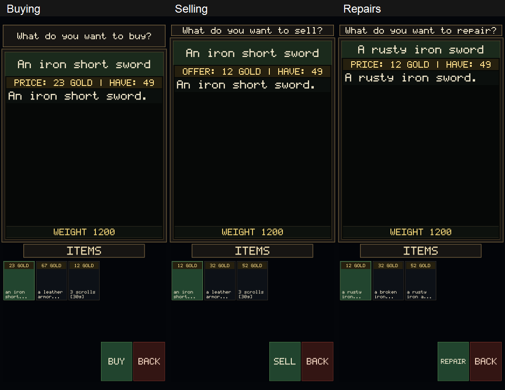
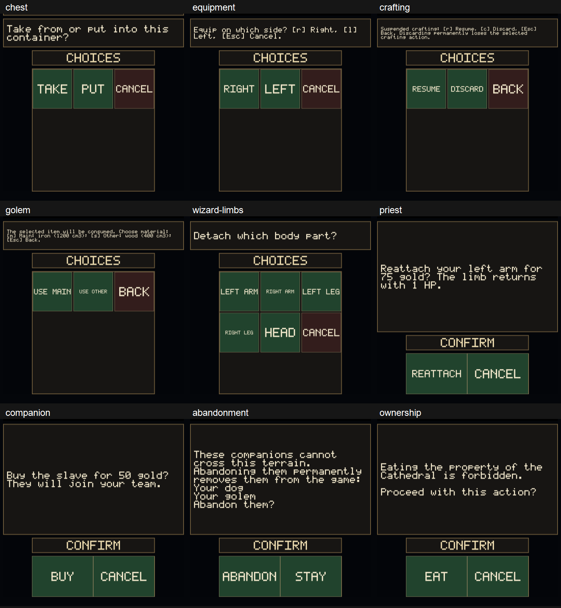

# 0.59-android.10 - Clearer choices and upfront prices

This update makes shopping, containers, and service prompts easier to understand before you commit to an action.

- Merchant item lists show prices before selection, including goods inside shop containers. Purchases use **Buy** instead of **Stash**.
- Selling and repair lists show offers or fees up front. The detail bar combines the amount and your balance: **OFFER: 12 GOLD | HAVE: 49**. Stack quotes identify the total and item count.
- Unavailable repairs show why they cannot proceed.
- Chests use **Take / Put / Cancel**. Equipment-side choices, suspended crafting, golem materials, and wizard body-part choices use action names rather than upper/lowercase key labels.
- Priest and companion-purchase prompts show the service or character and the price. Repair confirmations identify the item and fee.
- Ownership warnings keep the warning visible. Abandonment identifies the companions affected and explains that they are permanently removed.

## Screenshots

These are captures from the game's UI renderer with sample data, not artwork or concept mockups. The test scene omits gameplay backgrounds and item sprites so the changed controls and text are easy to inspect.

## Equipment behavior

This update does not add a new Both Hands command. Eligible two-handed weapons still automatically use both hands when the other arm is usable and empty.

## Verification

The interaction fixture covers portrait, landscape, and narrow layouts, price display, named choices, and touch input. Six CTest suites pass. Release APK/AAB and Android lint are checked before upload. No connected-phone smoke test was available for this release.
